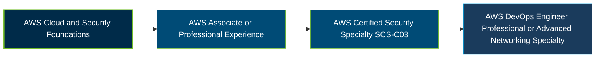

# AWS Certified Security - Specialty Certification Exam Guide

A dedicated, comprehensive study guide and cloud security reference repository for candidates preparing for the **AWS Certified Security - Specialty (SCS-C03) Certification Exam**.

---

## Exam Overview

The AWS Certified Security - Specialty certification validates advanced skills in designing, implementing, and managing security solutions for AWS workloads and applications, including identity protection, incident response, infrastructure security, and data protection.

- **Exam Format**: Multiple-choice, multiple-response, ordering, and matching questions.
- **Target Audience**: Cloud security engineers, security architects, security operations professionals, and experienced IT security practitioners.
- **Prerequisites**: No mandatory prior certification. AWS recommends substantial IT security experience and hands-on experience securing AWS workloads.

---

## Core Exam Domains & Knowledge Areas

### 1. Detection

- Design monitoring, alerting, and security event aggregation across AWS accounts and workloads.
- Configure logging sources, centralized log storage, analysis, and correlation.
- Troubleshoot security monitoring, logging, and alerting configurations.

### 2. Incident Response

- Design, implement, and test incident response plans, runbooks, and automated remediation.
- Investigate security events using logs, forensic artifacts, and AWS security findings.
- Contain threats, eradicate vulnerabilities, recover affected resources, and perform root cause analysis.

### 3. Infrastructure Security

- Implement network edge protections using AWS WAF, AWS Shield, and related services.
- Secure compute workloads through hardened images, vulnerability scanning, patching, and access controls.
- Design network security, segmentation, hybrid connectivity, and generative AI application guardrails.

### 4. Identity and Access Management

- Design authentication for users, applications, and systems using IAM, IAM Identity Center, and temporary credentials.
- Implement authorization strategies, cross-account access, and role-based or attribute-based access control.
- Apply least-privilege policies and troubleshoot unintended permissions and access failures.

### 5. Data Protection

- Secure data in transit through encryption, TLS configurations, and private connectivity.
- Protect data at rest using AWS KMS, CloudHSM, integrity controls, retention, and backup strategies.
- Manage credentials, secrets, cryptographic keys, certificates, and sensitive data masking.

### 6. Security Foundations and Governance

- Centrally manage AWS accounts, organizations, Control Tower, and organization-level policies.
- Apply secure infrastructure-as-code deployment, resource tagging, and centralized configuration controls.
- Evaluate compliance, remediate noncompliant resources, and collect audit evidence.

---

## Certification Path

The following is a suggested progression based on AWS's guidance, not a mandatory prerequisite sequence.

---

## Recommended Practice & Study Resources

Combine official AWS exam preparation materials with practical security exercises and supplementary practice resources.

- **CertsGate**: Explore [AWS SCS-C03 certification preparation resources](https://certsgate.com/exams/amazon-web-services/scs-c03) for supplementary study materials and practice questions.
- **AWS Hands-On Security Practice**: Use [AWS Builder Labs and AWS Security documentation](https://docs.aws.amazon.com/security/) to practice identity management, monitoring, incident response, encryption, and security governance.
